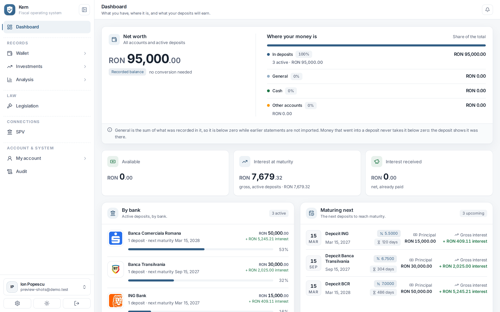
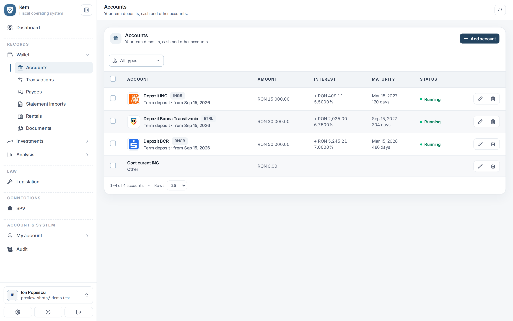
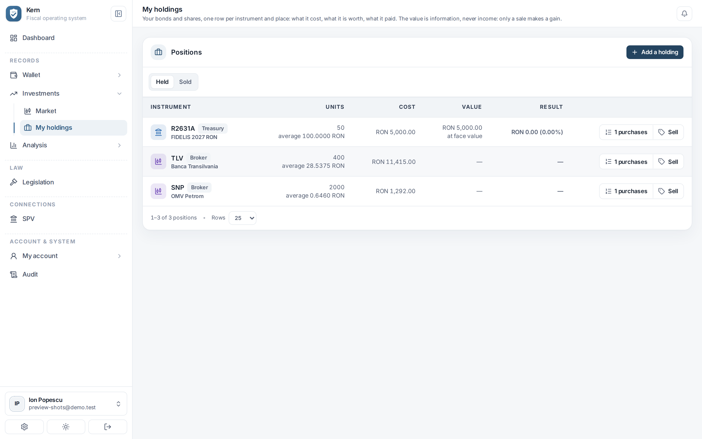
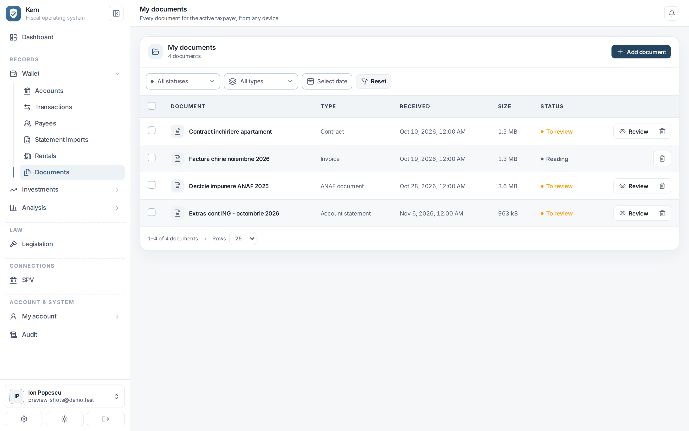
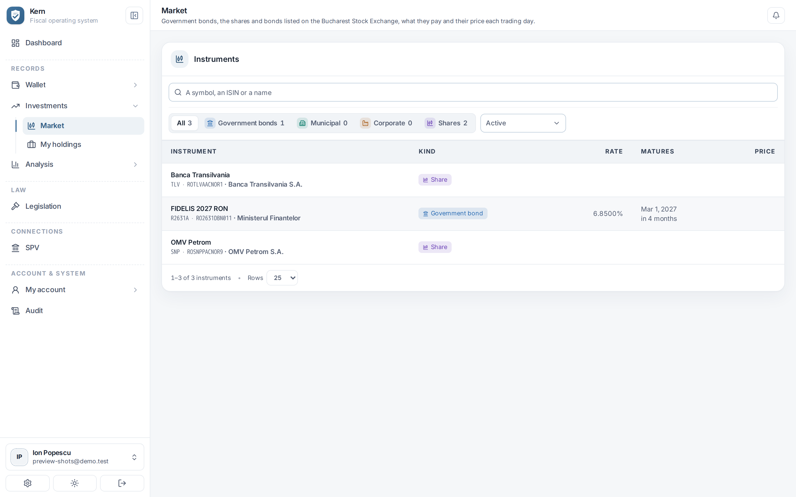

# Kern

Kern is a self-hosted tax workspace for Romania. It keeps a taxpayer's documents, reads them,
follows the SPV inbox and the law, and works out what is owed, all on a server you run.

It runs as one Docker Compose stack:

- **Laravel** with an Inertia/React interface;
- **Postgres** with pgvector, and **Redis**;
- **OpenBao**, the key vault for the encrypted taxpayer data;
- **ClamAV**, which scans every upload;
- a **Python** processing service, for document AI;
- a **Playwright** browser worker, for SPV sign-in;
- **Caddy** at the edge, for TLS.

---

## A look inside

Everything below runs against one taxpayer's own records, on your own server. These are the
installation's own screens, filled with sample data.

<p align="center">
  
</p>

<table>
  <tr>
    <td width="50%" valign="top">
      <br>
      <sub><b>Accounts</b> — term deposits, cash and other accounts, each with its bank.</sub>
    </td>
    <td width="50%" valign="top">
      <br>
      <sub><b>Investments</b> — your bonds and shares: what each cost, what it is worth, what it paid.</sub>
    </td>
  </tr>
  <tr>
    <td width="50%" valign="top">
      <br>
      <sub><b>Documents</b> — every document for the active taxpayer, from any device.</sub>
    </td>
    <td width="50%" valign="top">
      <br>
      <sub><b>Market</b> — government bonds and the shares and bonds listed on the Bucharest Stock Exchange.</sub>
    </td>
  </tr>
</table>

---

## Before you start

You need:

- **A Linux server** with Docker, Docker Compose v2 (`docker compose version` must answer), `make`
  and `openssl`. Installing from source also needs `git` and `npm`.
- **Memory.** About 7 GB of container limits with everything on one machine, or about 3 GB with the
  database, cache, vault and scanner on other machines. The installer shows the figure for your
  answers before it changes anything.
- **Object storage that speaks S3**, such as AWS S3, MinIO or Garage. You need an `https://` endpoint, an
  access key pair and two buckets: one for documents and one for uploads waiting for the virus scan.
  **Kern ships no object storage of its own**, so this has to exist first.
- **Optionally, a domain name pointed at the server**, for a certificate that browsers trust. Without
  one, the site works on the server's IP address with a certificate from its own CA. Browsers warn
  about it until that CA is imported (see [After installing](#after-installing)).

---

## Install on a server

There are two ways to install. Both run the same installer, `scripts/install.sh`, which:

1. asks about nine questions;
2. generates every secret;
3. writes `apps/api/.env` (mode 600);
4. starts the stack and runs the migrations;
5. creates the first administrator;
6. checks every service. If one it was told to run does not answer, the install fails.

### A. From a release (recommended)

Here the server gets no source code and builds nothing. A release is six images that CI built,
scanned and signed: the five the stack runs, and `kern-install`, which holds only the files that run
them (compose files, the installer, the updater, the signature check and the `.env` template).

```bash
# 1. Sign in to the registry, if the packages are private: a token with only `read:packages`.
docker login ghcr.io -u <github-user>

# 2. Check that the release's files were signed by this repository's CI, at exactly this tag.
#    cosign reads the signature from the registry itself, so it is handed the login from step 1:
#    the file `docker login` wrote, read-only, read as you (it is readable by its owner only).
VERSION=0.1.3
docker run --rm \
  -v "$HOME/.docker/config.json:/docker/config.json:ro" -e DOCKER_CONFIG=/docker \
  -u "$(id -u):$(id -g)" -e HOME=/tmp \
  ghcr.io/sigstore/cosign/cosign:v3.1.4@sha256:0f06154836d2de34f887a5c273506d52ca43edaa1d9e53e6510fa78a48f69c2d \
  verify \
  --certificate-identity "https://github.com/pack-a-kern/kern/.github/workflows/ci.yml@refs/tags/v$VERSION" \
  --certificate-oidc-issuer https://token.actions.githubusercontent.com \
  "ghcr.io/pack-a-kern/kern-install:$VERSION" >/dev/null && echo "signed by CI"

# 3. Only then copy them out, and install.
id=$(docker create "ghcr.io/pack-a-kern/kern-install:$VERSION" x)
docker cp "$id:/kern" kern && docker rm "$id"
cd kern
make install
```

- Replace `0.1.3` with the release you want. The releases are listed on the repository's
  **Tags** page.
- Step 2 is the one check you make by hand: everything after it is done by the files it checked.
  The installer refuses every image whose signature is not this repository's CI, for exactly that
  release, and nothing starts. The checks have to reach Sigstore's public services
  (`*.sigstore.dev`).
- With private packages, cosign in step 2 needs your `docker login` too: add
  `-v ~/.docker/config.json:/docker/config.json:ro -e DOCKER_CONFIG=/docker -u "$(id -u):$(id -g)" -e HOME=/tmp`
  right after `--rm`. It is read-only and gone when the check ends; the installer does the same.
- No git, npm or source code is needed.

### B. From source

This builds every image on the server from the checkout. It needs `npm`, and takes longer.

```bash
git clone https://github.com/pack-a-kern/kern.git
cd kern
make install
```

### What the installer asks

| Question | Answers |
|---|---|
| How will the site be reached? | By IP address (a certificate from its own CA) · a domain with ports 80 and 443 open (Let's Encrypt) · a domain behind Cloudflare's proxy (Let's Encrypt over DNS, with a Cloudflare API token) · a domain with a certificate you already have |
| Database, Redis, key vault, virus scanner | Install it here · use one I already run |
| Object storage | Its `https://` endpoint, key pair and two bucket names |
| Document AI, SPV automation | Install it here · use one I already run · skip it |
| Email | An SMTP server · skip it, and mail is written to the log |
| First administrator | An email address and a password |

Before it changes anything, it shows a summary and waits for a **yes**.

Any address on another machine must be `https://`. If that machine's certificate comes from a
private CA, the installer asks for the CA's certificate file.

---

## After installing

Open the address the installer printed and sign in as the administrator.

```bash
docker compose exec app php artisan kern:health   # every service, and whether it answers
make smoke                                        # is the login page up
docker compose ps                                 # every container should be "healthy"
```

**Reached by IP address?** The site's certificate comes from the installation's own CA. Export the
CA once and import it into each browser or device as a trusted authority. The warnings then stop,
renewals included:

```bash
make tls-ca      # writes kern-ca.crt
```

**Back up the key vault's volume.** It is the one thing that cannot be recovered. Lose it, and every
encrypted field in the database stays unreadable for good.

**Every secret is in `apps/api/.env`.** That file is not in git. Don't copy it anywhere else.

---

## Update

**Installed from a release:**

```bash
make update VERSION=0.2.0
```

This fetches the new release's files and checks their signature with the checker already on the
server, before one file is copied in. Then it pulls the new images and checks theirs. If either check
fails, nothing changes. If both pass, it runs the migrations, recreates only the containers whose
image changed, and health-checks the result. `apps/api/.env` and your certificates are never touched. To go back, run the same steps with the older version; note that a
migration is not undone by this.

**Installed from source:**

```bash
git pull
(cd apps/api && npm ci && npm run build)     # before the images: the edge image copies the built assets
make build
make install ARGS=--repair
```

---

## When something is wrong

```bash
make install ARGS=--repair
```

This asks nothing and writes no secrets. Against the installation that is already there, it:
- starts the stack;
- waits for the database;
- runs any pending migrations;
- syncs roles and permissions;
- runs the health check again.

It never overwrites `apps/api/.env`. Running the plain installer twice is refused for the same
reason.

```bash
make logs SERVICE=app                 # or queue, edge, postgres …
docker compose ps
```

---

## Development

For working on the code. This shape mounts your checkout into the containers, adds Mailpit, opens
Postgres and Redis on host ports and turns debug on. **Never use it on a machine others can reach.**

You need Docker, Docker Compose v2, `make`, and Node 20 with `npm`. You don't need PHP on the host:
composer runs inside the PHP 8.5 image.

```bash
git clone https://github.com/pack-a-kern/kern.git
cd kern

make env                 # writes apps/api/.env from every .env.example, development shape
```

Fill in the empty values in `apps/api/.env`. Each one has a sentence above it saying what it is, and
`docs/DEPLOYMENT.md` §4 explains them in detail. Generate secrets rather than typing them:
`openssl rand -hex 24` for passwords and tokens, and `base64:$(openssl rand -base64 32)` for
`APP_KEY`.

Then:

```bash
make vendor                                  # PHP dependencies, into apps/api/vendor
(cd apps/api && npm ci && npm run build)     # the frontend
make up                                      # start the stack
make migrate                                 # the schema
docker compose exec app php artisan kern:access:sync
docker compose exec app php artisan kern:admin:create you@example.com
```

PHP edits show up on the next request. After changing `apps/api/.env`, run `make reload`. After a
frontend change, run `npm run build` again.

### Tests and checks

```bash
make test              # PHP, Python and browser-worker suites, in their own images; needs nothing running
make check             # frontend, PHP lint/static analysis/tests and each package alone, against the running stack
make check-php-pg      # the suites that need real Postgres (uses the kern_test database, never kern)
make test-installer    # the installer's answers, written to a scratch file
make pins              # which pinned images have a newer upstream build
```

CI runs all of this on every push. It also runs secret scanning, dependency audits, and a
vulnerability scan of each image. Change requests go to this repository.

---

## Packages

Kern is a modular monolith. Each package is self-contained — it installs on its own, carries its own
README, tests and migrations, and reaches the others only through contracts, DTOs and events
(`deptrac` enforces the boundaries).

| Package | What it does |
|---|---|
| [`kern/platform`](packages/platform) | The security spine every application is built on — identity, tenancy, encryption, key management. Knows nothing about tax. |
| [`kern/legislation`](packages/legislation) | Reads a law from the source that publishes it and keeps every version it was ever shown — "what did this article say on 14 March 2023, and who says so". |
| [`kern/tax-romania`](packages/tax-romania) | Romanian tax for an individual (*persoană fizică*): the taxpayer, the wallet and deposits, the fiscal parameters read from the law, and the tax engine. |
| [`kern/investments`](packages/investments) | Government bonds for people (Fidelis, Tezaur) and the shares and bonds listed on the BVB — what each pays and when, with the source of every fact. |
| [`kern/documents`](packages/documents) | A tenant's documents from arrival to the moment a figure is read off one — upload in parts, quarantine, virus scan, encryption at rest, a text layer. |
| [`kern/notifications`](packages/notifications) | Notices for the application: an in-app bell, and the device's own notifications over Web Push. |
| [`kern/audit`](packages/audit) | An append-only, hash-chained audit log: each entry carries the hash of the one before it, so a tampered row is detectable. |

---

## Where to read more

| | |
|---|---|
| `docs/DEPLOYMENT.md` | Every container, every variable, secrets and keys, installing by hand |
| `docs/ESSENTIALS.md` | One page for anyone changing the code: the rules, the known traps, how to run things fast |
| `docs/ARCHITECTURE.md` | Module map and boundaries |
| `docs/STATUS.md` | What exists, what is in progress, what is blocked |
| `docs/SECURITY-FINDINGS.md` | Audit findings, and the controls verified sound |
| `BLUEPRINT.md` | The source of truth for the design |
